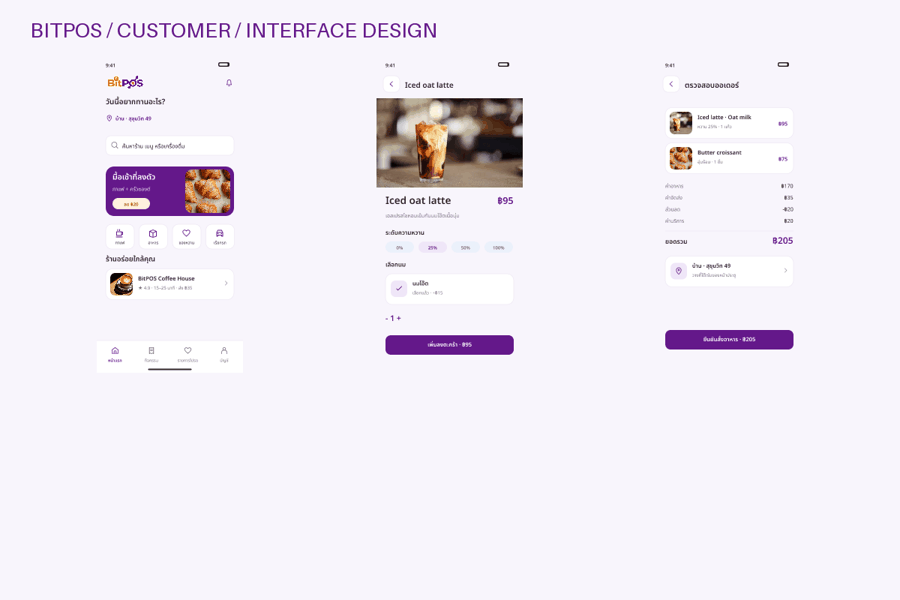

# BitPOS Website

Product website for BitPOS and BitPOS Mini, hosted independently from the merchant and customer applications.

- Domain: https://bitpos.cashlessthailand.com
- Merchant POS: https://pos.cashlessthailand.com
- Customer checkout: https://pay.cashlessthailand.com

## Run

`npm run dev` serves `public/` at http://localhost:8891. `npm run build` creates `dist/`.

Static output with a locally bundled Three.js viewer. Native JavaScript drives the scroll-scrubbed Blender sequence, rotatable STL-derived Mini model, automatically cycling screen textures, in-page video playback, bilingual copy, benefit counters and motion controls. Build dependencies are pinned in package-lock.json. The pitch film leads the cover; the interactive 3D Mini follows in the café-flow section. Videos load near the viewport and pause offscreen. Audible autoplay is attempted; when browser policy blocks it, playback falls back to muted with an enable-sound control and first-gesture unlock. Explicit mute choices are retained for the page session. Reduced-motion preferences disable automatic playback and screen cycling. A poster remains if WebGL is unavailable. YouTube remains an optional full-video link/modal.

The benefit figures are illustrative pilot targets, not measured business results. No external model/CDN runtime is required. Run `npm ci` before building a fresh checkout.

## Deploy

Import this repository in Vercel, use Other framework, build `npm run build`, output `dist`. Add the custom domain and use the DNS record supplied by that project's Vercel domain settings. Do not change existing `pos`, `pay` or `guide` records.

## Claims and assets

The existing café trial uses test USDG on Solana devnet. The real-device proof section shows a Gemini draft approved by the merchant and acknowledged by the physical Mini. Devnet USDC/x402 and BitPOS-issued USDT-test have separate runtime evidence. NFT loyalty artwork remains a concept; the embedded Copilot widget remains a simulation. Pickup audio and human voice acceptance remain separate from code/deployment evidence. The website does not connect wallets or handle payment keys.

`public/assets/asset-sources.json` records reused assets. Product renders/lifestyle/collectibles are illustrations; the café trial section uses actual trial media. Existing BitPOS wordmark, Blender renders and footage are supplied by the project owner. Font licenses are included next to font files. Project-owned source is Apache-2.0; brands, fonts and media retain their respective rights.

Mobile anatomy uses an uncropped contained frame between a separate title and two legible callout cards. It preserves the scroll-driven Blender sequence while shortening its mobile scroll span.

## Platform interface gallery

192 editable interface designs cover customer ordering, rider workflows, merchant POS and checkout, including distinct mobile and desktop compositions. These are design previews with illustrative data, not evidence of live delivery or ride operation. Current local Android/API/PostgreSQL/merchant-web evidence covers configured ordering and store pickup; payment verification in that joined fixture uses an explicitly SQL-only test seam.

[Customer](public/assets/platform/customer.webp) · [Rider](public/assets/platform/rider.webp) · [POS desktop](public/assets/platform/pos.webp) · [Pay desktop](public/assets/platform/pay.webp)

Source: owner-approved BitPOS FigCraft master, rendered 17 October 2026. Existing cafe/devnet evidence remains separate.
